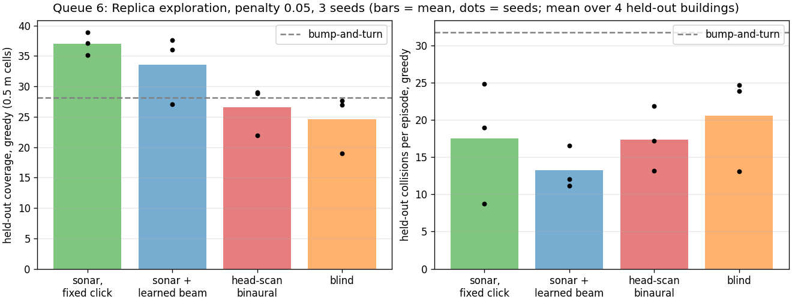

# Steam Audio echolocation: a validated, sample-accurate acoustic simulator for embodied agents

This repository takes Valve's **Steam Audio 4.8.1** ray-traced acoustics engine (the C API used by its Unreal Engine plugin),
validates its physics against analytic acoustics, patches its core to resolve individual echoes at sample resolution, and plugs it
into **Habitat-sim** so that reinforcement-learning agents can navigate and explore real 3-D buildings by sound, including by
emitting clicks and listening to the echoes like a bat.

Everything here was built and run on one Linux workstation between 2026-11-03 and 2026-11-10. The full chronological record of
every experiment, with all intermediate results and dead ends, is in [`docs/RESEARCH_LOG.md`](docs/RESEARCH_LOG.md).



*Headline result: exploring unseen Replica buildings in the dark (300 steps, 0.5 m coverage cells, three seeds per agent). An
agent given a range-by-bearing "sonar image" computed from its own click echoes covers about 50 % more floor than a blind agent
with a bump sensor, and beats a scripted bump-and-turn explorer with half its collisions.*

---

## Contents

1. [What is in here](#what-is-in-here)
2. [Key results](#key-results)
3. [Repository layout](#repository-layout)
4. [Setup](#setup)
5. [Reproducing the experiments](#reproducing-the-experiments)
6. [The patched Steam Audio core](#the-patched-steam-audio-core)
7. [The Habitat environment](#the-habitat-environment)
8. [Known limitations](#known-limitations)
9. [Licensing of third-party components](#licensing-of-third-party-components)

---

## What is in here

| Layer | What it does | Where |
|---|---|---|
| Physics validation | C harness with one reflecting wall; ~100 scenarios checked against image-source acoustics (timing, 1/r², absorption, air absorption, direction, occlusion, scattering) | `experiment/` |
| Patched core | Steam Audio core rebuilt with per-sample energy bins and a deterministic "sparse" reconstruction, so each reflection is one impulse at the right sample instead of 10 ms of noise; Embree tracer fixed to match | `patches/`, `scripts/build_core.sh` |
| Python binding | `ctypes` binding of the C API (scenes from any mesh, moving objects, direct + reflection simulation, Ambisonic IR extraction, binaural decode); struct layouts verified against the C compiler | `pysteamaudio/` |
| Box room | Shoebox validation of early reflections (image-source model) and reverberation time (Sabine/Eyring) | `experiment/box_room.py` |
| Gym environment | `SteamAudioNavEnv`: Habitat-sim scene, navmesh and agent; Steam Audio acoustics computed on the real scene mesh at every step | `habitat_audio/audio_nav_env.py` |
| Agents | Recurrent PPO (CNN encoders + GRU, auxiliary wall-distance head, optional click-beam head), vectorised multi-scene training, evaluation with ablations, episode videos with sound | `habitat_audio/` |
| Experiments | Seven queues of unattended training runs, from audio-goal navigation in one apartment to three-seed active-sensing comparisons over 18 Replica buildings | `habitat_audio/queue*.sh`, `habitat_audio/runs/` |

## Key results

**Simulator physics** (details: `experiment/results*/summary.md`)

* Stock library: **25/25** analytic checks pass. Reflection timing, 1/r² spreading, frequency-dependent absorption, air
  absorption, Ambisonic direction, occlusion and scattering behave as documented once Steam Audio's 10 ms energy bins are accounted for.
* Patched core in sparse mode: **26/26** checks, with reflection onsets accurate to one sample (21 µs at 48 kHz) instead of ±10 ms.
* Box room 6 × 4 × 3 m: **7/7** checks (image-source early reflections, RT60 vs Sabine/Eyring). The Embree build reproduces the default tracer to 4 digits.
* Physics caveat found: specular reflection energy scales with cos θ of incidence (the Blinn-Phong lobe lacks the 1/cos θ
  Jacobian), so grazing reflections are weaker than an image source predicts (`experiment/results_sparse/incidence_sweep.md`).
* Upstream bugs found and fixed: an aligned SSE load in the non-IPP convolution path (segfault), `-fabi-version=6` breaking GCC ≥ 10
  builds, and a hard-coded 10 ms bin in the Embree ISPC kernel.

**Embodied agents** (details: `docs/RESEARCH_LOG.md`, `habitat_audio/runs/queue*_results.md`)

| Question | Finding |
|---|---|
| Can PPO find a sound source by hearing Steam Audio acoustics? | Yes: 75–79 % success on audio-goal navigation in a Habitat test apartment. |
| Do agents use self-generated echoes? | Only when collisions cost something; then they use them first for wall avoidance. A head-scan (three click directions) agent reached 64 % point-goal success vs 20 % blind on one building, and fell back to blind level when its echoes were shuffled. |
| Does it transfer to unseen buildings? | Not with 1–3 training buildings. With 14 Replica buildings it does: held-out results match training results. |
| Do echoes help goal-directed navigation when a goal vector is given? | No. Echo and blind agents tie on held-out success (0.38 vs 0.39); removing echoes only doubles collisions. |
| Do echoes help exploration without a goal? | Yes, clearly. See the table below. |
| Which echo representation works best? | A range × azimuth **sonar image** computed directly from the first-order Ambisonic click response (intensity-vector direction per arrival). It beats a binaural spectrogram head-scan and runs 3–5× faster. |
| Does letting the agent steer a narrow click beam help? | Not measurably: within seed noise of a fixed omnidirectional click. Each seed learns a different clicking habit. |

Exploration in the dark on four held-out Replica buildings (collision penalty 0.05, mean ± s.d. over three seeds):

| Agent | Coverage (0.5 m cells) | Collisions / episode |
|---|---|---|
| Sonar image, fixed click | **37.0 ± 1.5** | 17.5 ± 6.7 |
| Sonar image + learned beam | 33.6 ± 4.7 | **13.2 ± 2.4** |
| Head-scan binaural spectrogram | 26.6 ± 3.3 | 17.4 ± 3.6 |
| Blind (bump sensor) | 24.5 ± 3.9 | 20.6 ± 5.3 |
| Scripted bump-and-turn | 28.1 | 31.8 |

## Repository layout

```
README.md                    this file
docs/RESEARCH_LOG.md         chronological record of everything (physics, patches, every training queue, caveats)
patches/                     steam-audio-4.8.1-echolocation.patch (diff against Valve's v4.8.1 core)
scripts/fetch_sdk.sh         download the stock 4.8.1 SDK (headers, docs, stock libphonon.so) into sdk/
scripts/build_core.sh        clone v4.8.1, apply the patch, build sdk/lib/patched/ and sdk/lib/patched_embree/
experiment/                  C harness + analysis: single wall, incidence sweep, box room
  wall_experiment.c, Makefile, run_scenarios.py, analyze.py, incidence_sweep.py, box_room.py, test_binding.py
  env_stock.sh, env_patched.sh   select library and reconstruction mode
  results/ results_sparse/ results_box*/   summaries, checks.json, figures (raw IRs not committed)
pysteamaudio/                ctypes binding (README.md inside), check_layout.c struct-layout verifier
habitat_audio/               gym environment, PPO, evaluation, videos (README.md inside)
  audio_nav_env.py           SteamAudioNavEnv (goal sound, click echoes, head scan, sonar image, beams, exploration)
  scene_mesh.py              scene mesh loading in Habitat's frame, cached per scene
  vec_env.py                 multi-process vectorised environments, one scene per worker
  ppo_train.py               recurrent PPO; task presets in TASKS; scene list in SCENES
  ppo_eval.py                evaluation vs random / oracle / bump-and-turn, echo ablations
  make_video.py              episode videos: RGB, top-down map, observation panels, binaural soundtrack
  validate_env.py, validate_echo.py, validate_sonar.py     environment checks
  summarize_seeds.py         mean ± s.d. over seeds for queue 6
  queue*.sh, launch_train.sh unattended training queues as they were run
  runs/                      per-run log.csv, learning curves, evaluation JSON, queue*_results.md (checkpoints not committed)
  videos/                    example episodes (mp4 with sound, wav, frame)
```

Not committed (regenerable or third-party): `sdk/`, `core_src/`, `downloads/`, `unreal_plugin/`, policy checkpoints (`*.pt`,
~30 MB each, 130 of them), raw impulse responses (`*.f32`), scene-mesh caches (`*.npz`) and training logs (`*.log`).

## Setup

Tested on Ubuntu 22.04, x86-64, GCC 11, CMake 3.22, an NVIDIA GPU for the policy (the acoustics run on the CPU).

**1. Steam Audio**

```bash
scripts/fetch_sdk.sh          # stock SDK -> sdk/include, sdk/doc, sdk/lib/stock/libphonon.so
scripts/build_core.sh         # patched core -> sdk/lib/patched/, sdk/lib/patched_embree/ (clones into core_src/)
```

`build_core.sh` reproduces the CMake options of the original builds (no IPP, PFFFT, AVX, static runtime; Embree on for the second
build). The original libraries were built step by step; the script itself has not been run end to end from a clean checkout.

The Unreal Engine plugin is not part of this repository. Valve's `steamaudio_unreal_4.8.1.zip` (from the same GitHub release)
works with UE 4.27 and later and embeds exactly this C API; the plugin bundled with UE 5.1 is an obsolete 2.0 beta.

**2. Python environment (for the binding and the Habitat work)**

The Habitat work uses a conda environment named `ss` with Python 3.9, habitat-sim 0.2.2, habitat-lab 0.2.2, SoundSpaces,
PyTorch, trimesh, embreex, librosa, soundfile, scikit-image and OpenCV. Conda's bundled libstdc++ is older than the one the rebuilt
core needs, so preload the system one:

```bash
export LD_PRELOAD=/usr/lib/x86_64-linux-gnu/libstdc++.so.6
```

The binding also loads it itself if it is imported before numpy.

**3. Scenes**

* Habitat test scenes (`apartment_1`, `skokloster-castle`, `van-gogh-room`) and the MP3D example house `17DRP5sb8fy`, as installed with SoundSpaces.
* **Replica** (18 scenes, 74 GB with Habitat meshes and navmeshes) under `~/sound-spaces/data/scene_datasets/Replica-Dataset`.

Scene paths are set in `SCENES` in `habitat_audio/ppo_train.py`.

## Reproducing the experiments

```bash
# physics validation (C harness)
cd experiment && make
source env_stock.sh   && python3 run_scenarios.py --results results         && python3 analyze.py --mode linear --results results
source env_patched.sh && python3 run_scenarios.py --rays-default 262144 --results results_sparse && python3 analyze.py --mode sparse --results results_sparse
python3 box_room.py --lib patched --out results_box

# environment checks
cd .. && python -m habitat_audio.validate_env && python -m habitat_audio.validate_echo && python -m habitat_audio.validate_sonar

# train and evaluate one agent (queue 6 setting)
bash habitat_audio/launch_train.sh habitat_audio/runs/my_sonar --task explore_sonar --aux 0.5 --echo-dropout 0.05 \
     --collision-penalty 0.05 --steps 2000000 --envs 14 --env-threads 1 --scenes replica/apartment_0,replica/office_0,...
python -m habitat_audio.ppo_eval --ckpt habitat_audio/runs/my_sonar/checkpoint.pt --episodes 30 --scene replica/office_2
python -m habitat_audio.ppo_eval --ckpt ... --scene replica/office_2 --ablate shuffled --skip-baselines
python -m habitat_audio.make_video --ckpt ... --scene replica/office_2 --episodes 2
```

`launch_train.sh` deletes and recreates its output directory. To continue a run, call `ppo_train` with `--resume <dir>/checkpoint.pt`.
The exact command lines of every reported run are in `habitat_audio/queue*.sh`.

Task presets (`--task`): `audiogoal`, `blind_pointgoal`, `echo_pointgoal`, `echo_scan_pointgoal`, `echo_audiogoal`,
`explore_blind`, `explore_echo`, `explore_echo_scan`, `explore_sonar`, `explore_sonar_beam`, `sonar_beam_pointgoal`,
`audiogoal_nosliding`, `echo_audiogoal_nosliding`.

Throughput with 14 workers (one Steam Audio thread each, Embree build): blind ≈ 750 steps/s, sonar ≈ 380–650 steps/s, head-scan binaural ≈ 70–180 steps/s.

## The patched Steam Audio core

All changes are behind environment variables, so with none set the library behaves exactly like Valve's.

| Variable | Effect |
|---|---|
| `STEAMAUDIO_BIN_DURATION` | Energy-histogram bin length in seconds (Valve: 0.01). One sample, e.g. `4.1666667e-5` at 24 kHz, makes every reflection path land in its own bin. |
| `STEAMAUDIO_RECONSTRUCTION=sparse` | Replaces the noise-based reconstruction with one impulse per bin at amplitude `Y(d)·sqrt(4πE)`, positive polarity for peaked arrivals, and a zero-phase, exactly complementary three-band split. |
| `STEAMAUDIO_LIB`, `STEAMAUDIO_EMBREE=1` | Binding-side: choose the library file and the Embree ray tracer. |

Changed files: `energy_field.cpp`, `reconstructor.h/.cpp`, `simulation_manager.cpp`, `api_simulator.cpp`, `api_reconstructor.cpp`,
`reflection_simulator.cpp`, `embree_reflection_simulator.cpp/.ispc` (bin duration passed to the ISPC kernel), `array_math.cpp`
(upstream unaligned-load fix), `CMakeLists.txt` (`-fabi-version=6` removed). See `docs/RESEARCH_LOG.md` for the derivations and the validation.

## The Habitat environment

`SteamAudioNavEnv(scene, **options)` combines Habitat-sim motion (0.25 m steps, 10° turns, optional wall sliding) with Steam Audio
acoustics computed on the same mesh at every step. Observations can include:

* `spectrogram`: the goal sound (1 s clip) through the binaural room response, as in SoundSpaces' AudioGoal sensor.
* `echo`: binaural echo spectrograms of the agent's own click, optionally at several head angles with a cardioid beam (head scan).
* `sonar`: a 64 × 32 range × azimuth image (17 cm × 11.25°) built from the Ambisonic click response, plus a signed elevation channel for floor and ceiling.
* `pointgoal` (distance, bearing), `contact` (bump sensor), and optional RGB or depth.

Further options: exploration mode with a coverage reward, collision penalty, learned click beams with a per-click cost, blank-echo
augmentation, and ray-cast wall distances as auxiliary training labels. `habitat_audio/README.md` documents the API.

## Known limitations

* Results come from simulation only. Steam Audio is a geometric (ray) model: no diffraction, two-sided triangles, and the cos θ grazing-reflection deficit noted above.
* The sparse reconstruction yields one arrival per sample, which is cleaner than real first-order recordings, where overlapping arrivals blur direction.
* Most queues before queue 6 used one seed per configuration. Queue 6 showed per-building rankings and collision counts change between seeds, so small single-seed differences in earlier queues are provisional.
* Agents still depend heavily on echoes: with the echo input blanked at test time most policies cover only 8–20 cells.
* Paths in scripts assume the repository lives at `~/steamaudio` and SoundSpaces data at `~/sound-spaces/data`.

## Licensing of third-party components

Steam Audio is © Valve Corporation, licensed under the Apache License 2.0. `patches/` contains modifications to its source, and
`pysteamaudio/` is a binding to its public C API. Habitat-sim, habitat-lab and SoundSpaces are © Meta Platforms under the MIT
licence. Replica is © Meta Platforms under its own research licence and is not redistributed here. No licence has been chosen
yet for the original code in this repository.
